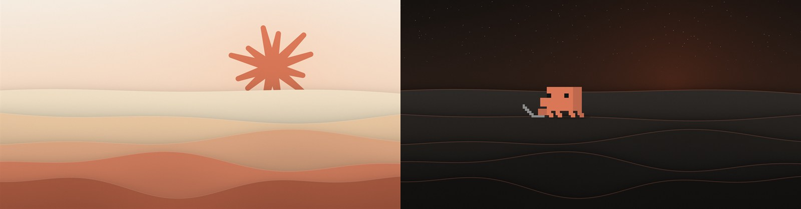
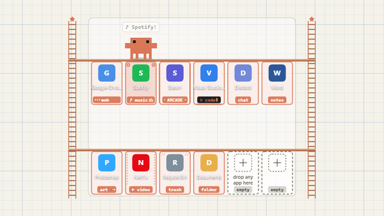

<div align="center">



# Live Wallpaper

**Animated desktop wallpapers for Windows.**

Each one runs inside [Lively Wallpaper](https://github.com/rocksdanister/lively), a free and open-source app.<br>
Most also come with still images, so you can use them without installing anything.

<p>
  
  
  
  <a href="LICENSE"></a>
  
</p>

<p>
  <a href="#wallpapers">Wallpapers</a> ·
  <a href="#what-you-need">What you need</a> ·
  <a href="#how-to-use-a-live-wallpaper">How to use</a> ·
  <a href="#set-up-each-wallpaper">Set up each wallpaper</a> ·
  <a href="#no-lively-use-the-still-images">Still images</a> ·
  <a href="#troubleshooting">Troubleshooting</a> ·
  <a href="#license-and-notice">License</a>
</p>

</div>

> [!NOTE]
> Unofficial fan art. Not affiliated with or endorsed by Anthropic. See [License and notice](#license-and-notice).

---

## Wallpapers

| Preview | Wallpaper | What it is | Download |
| --- | --- | --- | --- |
| <a href="wallpapers/claude-dunes"></a> | **[Claude Dunes](wallpapers/claude-dunes)** | A clay-orange spark rising over slowly drifting dunes. Day, sunset and night looks. | [**Claude-Dunes.zip**](https://github.com/Hirukadeven07/Live-Wallpaper/raw/main/wallpapers/claude-dunes/Claude-Dunes.zip) |
| <a href="wallpapers/clawd-dunes"></a> | **[Clawd Dunes](wallpapers/clawd-dunes)** | Clawd, the Claude Code mascot, wandering the same dunes. He walks, waves, dances, meditates and sits down at a laptop. | [**Clawd-Dunes.zip**](https://github.com/Hirukadeven07/Live-Wallpaper/raw/main/wallpapers/clawd-dunes/Clawd-Dunes.zip) |
| <a href="wallpapers/clawd-desk-buddy"></a> | **[Clawd Desk Buddy](wallpapers/clawd-desk-buddy)** | A tiny Clawd who lives on your desktop. He follows your cursor, reacts to clicks, taps the clock and battery on the taskbar, and naps when you're away. Pet him, feed him cookies, play ball, high-five him. Five backgrounds, or use your own picture. | [**Clawd-Desk-Buddy.zip**](https://github.com/Hirukadeven07/Live-Wallpaper/raw/main/wallpapers/clawd-desk-buddy/Clawd-Desk-Buddy.zip) |
| <a href="wallpapers/clawd-desk-stations"></a> | **[Clawd Desk Stations](wallpapers/clawd-desk-stations)** | A shelf of slots on your desktop icon grid, as many as you like. Drag any app's icon in and Clawd works out what it is and climbs over to play with it: he surfs, dances, games, codes, chats, paints and watches. Comes with Clawd's Eyes, a small helper that lets him see which app is where. | [**Clawd-Desk-Stations.zip**](https://github.com/Hirukadeven07/Live-Wallpaper/raw/main/wallpapers/clawd-desk-stations/Clawd-Desk-Stations.zip)<br>[**Clawd-Eyes.zip**](https://github.com/Hirukadeven07/Live-Wallpaper/raw/main/wallpapers/clawd-desk-stations/Clawd-Eyes.zip) |
| <a href="wallpapers/clawd-tunes"></a> | **[Clawd Tunes](wallpapers/clawd-tunes)** | A music player for Spotify on your desktop, with Clawd dancing on top in his headphones. Five player styles (card, wide, slim bar, bubbles, turntable) whose buttons really control Spotify. He reads out each new song, freezes when you pause, goes wild when the beat drops, and presses buttons when you throw him at them. Comes with Clawd's Ears, a small helper that lets him hear Spotify. | [**Clawd-Tunes.zip**](https://github.com/Hirukadeven07/Live-Wallpaper/raw/main/wallpapers/clawd-tunes/Clawd-Tunes.zip)<br>[**Clawd-Ears.zip**](https://github.com/Hirukadeven07/Live-Wallpaper/raw/main/wallpapers/clawd-tunes/Clawd-Ears.zip) |

Click a wallpaper's name to see its settings and still images. For the steps to get each one running, see [Set up each wallpaper](#set-up-each-wallpaper).

## What you need

- Windows 10 or 11
- [Lively Wallpaper](#step-1-install-lively-wallpaper) (free)
- A graphics card or integrated GPU that supports WebGL 2. Any PC from the last several years does. If yours doesn't, the wallpaper shows a simpler version of the scene instead of failing.

## How to use a live wallpaper

### Step 1: Install Lively Wallpaper

Pick one way. Skip this step if you already have Lively.

- **Microsoft Store:** [Lively Wallpaper on the Microsoft Store](https://apps.microsoft.com/detail/9ntm2qc6qws7) (publisher: Sketches SRL, the developer's company). Click **Get**.
- **Direct download:** [Lively releases on GitHub](https://github.com/rocksdanister/lively/releases). Under the newest release, download the file named `lively_setup_x86_full_...exe` and run it.
- **Command line:** open PowerShell and run:

  ```powershell
  winget install --id rocksdanister.LivelyWallpaper --source winget
  ```

If the Microsoft Store install fails with an error code, use the direct download or the command line instead.

### Step 2: Download the wallpaper

Click the download link in the [table above](#wallpapers), or use the one from the wallpaper's own folder. You get a `.zip` file.

> [!IMPORTANT]
> **Don't unzip the wallpaper's zip.** Lively reads it as it is. (Clawd Desk Stations and Clawd Tunes also come with a small helper in a second zip. That one you do unzip; see [Set up each wallpaper](#set-up-each-wallpaper).)

### Step 3: Add it to Lively

1. Open Lively. If you can't see it, click its icon in the system tray (bottom-right of the taskbar, behind the `^` arrow).
2. **Drag the `.zip` file onto the Lively window.**
   Or click the **+** button at the top of Lively, choose to add a wallpaper from a file, and select the `.zip`.
3. Click **Import** or **Add** if Lively asks you to confirm.

### Step 4: Set it as your wallpaper

Click the wallpaper's tile in Lively's library. It becomes your desktop background straight away.

> [!TIP]
> To see it, minimize your windows or press **Win + D**.

### Step 5: Finish setting it up

Some wallpapers need one or two more steps, such as letting them see your mouse or starting their helper. Find yours in [Set up each wallpaper](#set-up-each-wallpaper) below.

To change how a wallpaper looks or behaves, right-click its tile in Lively and choose **Customise**.

### Go back to your old wallpaper

In Lively, right-click the wallpaper that is playing and choose **Close wallpaper**, or pick another tile. To remove a wallpaper completely, right-click its tile and choose **Delete**.

## Set up each wallpaper

Steps 1 to 4 of [How to use a live wallpaper](#how-to-use-a-live-wallpaper) are the same for every wallpaper: install Lively, download the zip, drag it onto Lively, click its tile. Here's what each one needs on top of that.

### Claude Dunes

The spark over the dunes. Nothing extra to set up.

1. Download [**Claude-Dunes.zip**](https://github.com/Hirukadeven07/Live-Wallpaper/raw/main/wallpapers/claude-dunes/Claude-Dunes.zip) and drag it onto Lively. Don't unzip it.
2. Click its tile. That's it.
3. Optional: right-click the tile, choose **Customise**, and pick the look (match Windows, light, dark or follow the clock), how fast the dunes drift, and stars or paper grain.

Settings: [Claude Dunes settings](wallpapers/claude-dunes#settings). No Lively? Use its [still images](wallpapers/claude-dunes/still-images).

### Clawd Dunes

Clawd wandering the dunes.

1. Download [**Clawd-Dunes.zip**](https://github.com/Hirukadeven07/Live-Wallpaper/raw/main/wallpapers/clawd-dunes/Clawd-Dunes.zip) and drag it onto Lively. Don't unzip it.
2. Click its tile.
3. Optional: so Clawd can turn toward your cursor, open Lively's **Settings**, go to **Wallpaper**, and set **Wallpaper input** to **Mouse**.
4. Optional: right-click the tile and choose **Customise** for Clawd's size, the look and the dune speed.

Settings: [Clawd Dunes settings](wallpapers/clawd-dunes#settings). No Lively? Use its [still images](wallpapers/clawd-dunes/still-images).

### Clawd Desk Buddy

A tiny Clawd you can play with.

1. Download [**Clawd-Desk-Buddy.zip**](https://github.com/Hirukadeven07/Live-Wallpaper/raw/main/wallpapers/clawd-desk-buddy/Clawd-Desk-Buddy.zip) and drag it onto Lively. Don't unzip it.
2. Click its tile.
3. **Let Clawd see your mouse (needed).** Open Lively's **Settings**, go to **Wallpaper**, and set **Wallpaper input** to **Mouse**. Without this he can't follow your cursor or react to clicks.
4. Press **Win + D** and try it: rest your cursor somewhere, click him, rub the cursor over him, double-click empty desktop for a ball. The full list is in [Things to try](wallpapers/clawd-desk-buddy#things-to-try).
5. Optional: right-click the tile and choose **Customise** for the background (or your own picture), Clawd's size, naps and toys.

Settings: [Clawd Desk Buddy settings](wallpapers/clawd-desk-buddy#settings). No Lively? Use its [still images](wallpapers/clawd-desk-buddy/still-images).

### Clawd Desk Stations

A shelf on your icon grid where Clawd plays with your apps. It comes with a helper, **Clawd's Eyes**, so you download two files.

1. Download [**Clawd-Desk-Stations.zip**](https://github.com/Hirukadeven07/Live-Wallpaper/raw/main/wallpapers/clawd-desk-stations/Clawd-Desk-Stations.zip) and drag it onto Lively. Don't unzip it. Click its tile.
2. **Let Clawd see your mouse.** In Lively's **Settings** > **Wallpaper**, set **Wallpaper input** to **Mouse**.
3. **Start Clawd's Eyes.** Download [**Clawd-Eyes.zip**](https://github.com/Hirukadeven07/Live-Wallpaper/raw/main/wallpapers/clawd-desk-stations/Clawd-Eyes.zip), unzip it somewhere you'll keep it (such as Documents), and double-click **Start Clawd Eyes.cmd**. A small Clawd appears in the system tray. Right-click him there and tick **Start with Windows** if you want it every time.
4. **Set up your desktop icons.** Right-click an empty spot on the desktop and open **View**: tick **Show desktop icons**, turn **Auto arrange icons** off, and turn **Align icons to grid** on.
5. **Choose how many slots.** Right-click the tile in Lively, choose **Customise**, and set **How many slots** and **Slots in each row**.
6. **Fill the slots.** Drag app icons from your desktop into the slots. Clawd climbs over to play with each one.

More detail: [Set it up](wallpapers/clawd-desk-stations#set-it-up) and [Clawd Desk Stations settings](wallpapers/clawd-desk-stations#settings). This one has no still images; it only works live.

### Clawd Tunes

A Spotify player with Clawd dancing on top. It comes with a helper, **Clawd's Ears**, so you download two files. You need the Spotify app for Windows; the web player in a browser doesn't work.

1. Download [**Clawd-Tunes.zip**](https://github.com/Hirukadeven07/Live-Wallpaper/raw/main/wallpapers/clawd-tunes/Clawd-Tunes.zip) and drag it onto Lively. Don't unzip it. Click its tile.
2. **Let the player see your mouse.** In Lively's **Settings** > **Wallpaper**, set **Wallpaper input** to **Mouse**. Without this the player's buttons can't be clicked.
3. **Start Clawd's Ears.** Download [**Clawd-Ears.zip**](https://github.com/Hirukadeven07/Live-Wallpaper/raw/main/wallpapers/clawd-tunes/Clawd-Ears.zip), unzip it somewhere you'll keep it (such as Documents), and double-click **Start Clawd Ears.cmd**. A small Clawd with headphones appears in the system tray. Right-click him there and tick **Start with Windows** if you want it every time.
4. **Play something in Spotify.** Press **Win + D**: the player shows your song and Clawd starts dancing. Its buttons control Spotify.
5. **Put the player where you want it.** Drag it by an empty part, or right-click the tile, choose **Customise**, and pick **Where the player sits** (or **Your own spot** and its two sliders). It always keeps a gap from the screen edges, and you can change how big that gap is.
6. Optional: in **Customise**, pick the **Player style** (card, wide, slim bar, bubbles or turntable), colours, background and how much Clawd dances. To try it before setting up the helper, tick **Play made-up demo songs**.

More detail: [Set it up](wallpapers/clawd-tunes#set-it-up) and [Clawd Tunes settings](wallpapers/clawd-tunes#settings). This one has no still images; it only works live.

## No Lively? Use the still images

Each wallpaper folder has a `still-images` folder with three pictures (2560 x 1600). Clawd Desk Stations and Clawd Tunes are the exceptions: they only work live. To use one:

1. Open the wallpaper's folder on GitHub and open the `still-images` folder.
2. Click an image, then click the download button (the arrow icon) on the right.
3. Right-click the downloaded file and choose **Set as desktop background**.

If your screen has a different shape, open **Settings > Personalization > Background** and set **Choose a fit** to **Fill**.

## Troubleshooting

<details>
<summary><b>The wallpaper doesn't move.</b></summary>

<br>

Lively pauses wallpapers by design when another window is maximized or covering the desktop, and on battery power if you've enabled that. Minimize your windows or press **Win + D** and it will start moving. You can change these rules in Lively's settings.

</details>

<details>
<summary><b>Clawd doesn't react to my cursor or clicks, or the player's buttons don't work.</b></summary>

<br>

Lively only passes the mouse to a wallpaper when you allow it. Open Lively's **Settings**, go to **Wallpaper**, and set **Wallpaper input** to **Mouse**. The wallpaper only sees the mouse while it's over the desktop, not over other windows.

</details>

<details>
<summary><b>Clawd Tunes says "Spotify isn't linked".</b></summary>

<br>

Start Clawd's Ears (double-click **Start Clawd Ears.cmd** in the folder you unzipped it to) and play something in the Spotify app. The Spotify web player in a browser doesn't count. See [Set it up](wallpapers/clawd-tunes#set-it-up).

</details>

<details>
<summary><b>It uses too much battery or GPU.</b></summary>

<br>

Right-click the tile, choose **Customise**, and set **Frame rate** to **15 fps (battery saver)**.

</details>

<details>
<summary><b>The wallpaper looks plain or flat.</b></summary>

<br>

Your graphics driver may not support WebGL 2, so you're seeing the fallback version. Updating your graphics driver usually fixes it.

</details>

<details>
<summary><b>The tile doesn't appear after adding the zip.</b></summary>

<br>

Close Lively fully from its tray icon (right-click > **Exit**), then open it again.

</details>

## License and notice

These are unofficial fan wallpapers. You can use and share them for noncommercial purposes under the [PolyForm Noncommercial License 1.0.0](LICENSE).

The Claude spark and the Clawd character belong to Anthropic, which is not affiliated with or endorsing this project, and they are not covered by that license. Keep them to personal use. Details are in [NOTICE.md](NOTICE.md).
