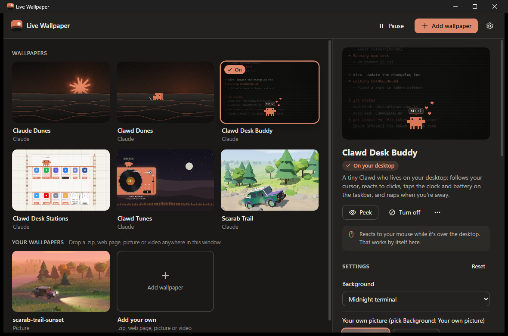

# Live Wallpaper (the app)

A small Windows app that plays this repository's wallpapers behind your desktop icons, without Lively Wallpaper.
It's one `LiveWallpaper.exe` with every wallpaper built in: open it, click a wallpaper, and it's on your desktop.



## What it does

- **No importing.** All six wallpapers come inside the app. Click one and it's on your desktop.
- **Settings next to the wallpaper.** Every change shows on the desktop as you make it, and is saved straight away.
- **No helpers to set up.** Clawd's Eyes (desktop icons for Clawd Desk Stations) and Clawd's Ears (Spotify for
  Clawd Tunes) are built in. They only run while those wallpapers are showing.
- **The mouse just works.** There's no "Wallpaper input" switch to find; wallpapers react to the mouse over the bare
  desktop.
- **Saves power by itself.** A wallpaper stops while a maximised or full-screen app covers its screen. After a few
  seconds it's also frozen and gives memory back. Locking the PC or turning the screen off does the same.
- **Your own wallpapers.** Drop a Lively `.zip`, a web page, a folder, a picture or a video onto the window.
- **One wallpaper per screen**, or the same on all of them.
- Starts with Windows (you can turn that off), lives in the tray, and quits cleanly, putting your normal wallpaper
  back.

## What you need

- Windows 10 or 11.
- The Microsoft Edge WebView2 Runtime. It comes with Windows 11 and is on almost every Windows 10 PC. If it's
  missing, the app says so and offers the download page.

## Using it

1. [Download `LiveWallpaper.exe`](https://github.com/Hirukadeven07/Live-Wallpaper/raw/main/LiveWallpaper.exe) and run it. The window opens and a small icon appears in the tray (bottom right, maybe behind `^`).
2. Click a wallpaper. That's it.
3. Change its settings on the right. If you have more than one screen, pick a screen at the top first.
4. Close the window whenever you like. The wallpaper keeps playing; click the tray icon to come back.

Right-click the tray icon for **Pause wallpapers**, **Start with Windows** and **Quit**.
The gear at the top right has the rest: pausing on battery, letting wallpapers react to the mouse, and
developer mode.

> [!NOTE]
> Close Lively Wallpaper (or stop its wallpaper) before you use this app, so the two don't both draw on the desktop.
> The old Clawd's Eyes and Clawd's Ears helpers aren't needed here, and it does no harm if they're still running.

`LiveWallpaper.exe --quit` closes the copy that's running; `--background` starts it without opening the window
(that's how Windows starts it at sign-in).

## Making your own wallpaper

A wallpaper is a folder with an `index.html`, in the same format as Lively Wallpaper, so one made for either app
works in both. In the app's settings, turn on **Developer mode** and press **Start a new wallpaper**: you get a
starter in your wallpapers folder (`%LOCALAPPDATA%\LiveWallpaper\Library\user`), already on your desktop and open
in File Explorer. Edit it, then choose **Reload** from the wallpaper's `⋯` menu. **Developer tools** in the same
menu opens Chrome's DevTools for the wallpaper.

What's in the folder:

| File | What it's for |
| --- | --- |
| `index.html` | The wallpaper. Anything a web page can do: canvas, WebGL, video, CSS animation. |
| `LivelyInfo.json` | Optional. `Title`, `Desc`, `Author`, `Thumbnail` (a picture in the folder) and `Arguments`. |
| `LivelyProperties.json` | Optional. The settings the app shows for it. |

How the page hears from the app (these are Lively's names, so wallpapers work in both):

| What | How |
| --- | --- |
| Settings | `livelyPropertyListener(name, value)` is called for every setting when the page loads, and again whenever one changes. |
| Pausing | `livelyWallpaperPlaybackChanged('{"IsPaused":true}')` when the desktop is covered, `false` when it's back. Stop drawing in between. |
| Sound | Add `--audio true` to `Arguments` and `livelyAudioListener(levels)` gets 128 numbers from 0 to 1 (low notes first), about 30 times a second. |
| The mouse | Normal `mousemove`, `mousedown`, `click`, `wheel` events while the cursor is over the bare desktop. A `mouseout` with no `relatedTarget` means it left. |
| Storage | `localStorage` and `IndexedDB` work and are kept separately for each wallpaper. |

Setting types for `LivelyProperties.json`:

```json
{
  "speed":  { "type": "slider",   "text": "Speed",       "value": 100, "min": 0, "max": 300, "step": 10 },
  "stars":  { "type": "checkbox", "text": "Stars",       "value": true },
  "look":   { "type": "dropdown", "text": "Look",        "value": 0, "items": ["Day", "Night"] },
  "tint":   { "type": "color",    "text": "Tint",        "value": "#D97757" },
  "name":   { "type": "textbox",  "text": "Your name",   "value": "" },
  "again":  { "type": "button",   "text": "Start over",  "value": "Restart" },
  "photo":  { "type": "folderDropdown", "text": "Picture", "value": "a.jpg", "folder": "pictures", "filter": "*.jpg|*.png" },
  "note":   { "type": "label",    "value": "Some text shown between the settings." }
}
```

A dropdown sends the number of the chosen item, a button sends `true`, and a folderDropdown sends
`folder\file.jpg`. The app shows a folderDropdown as a row of pictures with an **Add picture** button.

Live Wallpaper also reads a few optional extras, which Lively simply ignores:

| Field | On | What it does |
| --- | --- | --- |
| `"unit": "%"` | slider | Shown after the number, so the title doesn't need "(%)". |
| `"ends": ["Left", "Right"]` | slider | Words shown under the two ends of the slider. |
| `"resets": ["place", "spotX"]` | button | Puts those settings back to their defaults (in the window too) before the button is sent. |

When you add a picture or a video, the app wraps it in a small page with **Fit**, **Position** and
**Colour around it** settings (plus **Sound** and **Speed** for videos). Website wallpapers (Lively's type 3) open
the website.

## How it works

- **Behind the icons.** Explorer is asked to split the desktop (`Progman` message `0x052C`), which creates a
  `WorkerW` window between the wallpaper and the icons. Each wallpaper is a child window of it, one per screen, with
  a WebView2 inside. This works on Windows 10 and on Windows 11 24H2 and later, where the `WorkerW` moved inside
  `Progman`.
- **One browser engine.** Every wallpaper and the app's window share one WebView2 environment, and so one browser
  process and one GPU process. The window is a WebView2 too, and it's closed completely when you close it.
- **Pages are served from memory and disk by the app itself** (`http://<wallpaper>.wp.localhost/`). Nothing listens
  on the network, and each wallpaper gets its own storage.
- **The mouse.** Raw mouse input is read without taking it from anyone. While the cursor is over the bare desktop,
  the app posts normal mouse messages to the wallpaper's browser window. Wheel events and "the cursor left" are
  delivered by a small script added to each page, because Chromium ignores those messages when they come from
  outside.
- **Clawd's Eyes and Ears** are ports of the PowerShell helpers (`eyes.rs`, `ears.rs`). The wallpapers still ask
  for `clawd-eyes-data.js`, `clawd-tunes-data.js` and `http://127.0.0.1:47823`, exactly as they do under Lively, and
  the app answers those requests itself. Only that wallpaper's page can reach them, and no port is opened.
- **Sound for visualisers** comes from a loopback recording of the default speakers (nothing is saved), turned into
  128 levels on a pitch scale. It only runs while a wallpaper that asked for sound is playing.

Everything the app writes lives in `%LOCALAPPDATA%\LiveWallpaper`: `config.json` (your choices), `Library` (the
wallpapers), `WebView2` (the browser's cache and each wallpaper's storage) and `app.log` (problems, if any).
Deleting that folder resets the app.

## Building it

You need [Rust](https://rustup.rs) and the Visual Studio C++ Build Tools (the "Desktop development with C++"
workload, or just the MSVC compiler and a Windows SDK).

```powershell
cd app
cargo build --release
```

The exe is `app\target\release\LiveWallpaper.exe`. The build packs every `wallpapers\*\source` folder into it, so
rebuild after changing a wallpaper. `cargo test` checks the importer, the settings and the sound analyser.

`LiveWallpaper.exe` at the top of the repository is the copy the main README's download link points to. After a
release build, copy the new exe over it and commit it.

For testing, a debug build (`cargo build`) can run against a separate folder so it never touches your real settings
or Start-with-Windows entry, and can open its pages to Chrome DevTools:

```powershell
$env:LIVEWALLPAPER_DATA_DIR = "$env:TEMP\lw-test"; $env:LIVEWALLPAPER_DEBUG_PORT = 9229
.\target\debug\LiveWallpaper.exe
```

The source:

| File | What's in it |
| --- | --- |
| `src/main.rs` | Start-up, one copy at a time, the message loop |
| `src/host.rs` | The hidden window and the event queue everything runs through |
| `src/app.rs` | Which wallpaper plays where, pausing, the tray, and what the window asks for |
| `src/surface.rs` | One wallpaper on one screen: its window, its WebView2 and the Lively calls |
| `src/desktop.rs` | Screens, the layer behind the icons, and whether a screen is covered |
| `src/input.rs` | Passing the mouse to wallpapers |
| `src/library.rs` | The built-in and your own wallpapers, settings, and adding new ones |
| `src/serve.rs` | Answering the pages' requests (files, byte ranges for video) |
| `src/manager.rs` | The app's window |
| `src/eyes.rs`, `src/ears.rs` | Clawd's Eyes and Clawd's Ears, built in |
| `src/audio.rs` | Sound levels for visualisers |
| `src/tray.rs`, `src/dialogs.rs`, `src/config.rs`, `src/util.rs` | The tray icon, file pickers and Start with Windows, saved settings, helpers |
| `ui/` | The window's page (`index.html`, `app.css`, `app.js`) |
| `res/` | Icon (`make-icon.ps1` draws it), manifest and version info |
