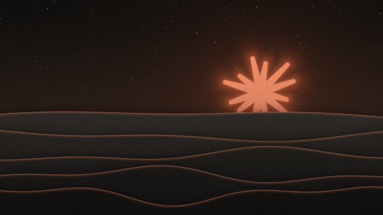

# Claude Dunes

A clay-orange spark rising over five layers of slowly drifting dunes. The sky follows your Windows theme (or the time of day), with stars at night.

## Download

- **Live wallpaper (Lively):** [Claude-Dunes.zip](https://github.com/Hirukadeven07/Live-Wallpaper/raw/main/wallpapers/claude-dunes/Claude-Dunes.zip). Don't unzip it; drag it onto the Lively window.
- **Still images (no app needed):** the [still-images](still-images) folder.

New to this? Follow the [step-by-step instructions](../../README.md#how-to-use-a-live-wallpaper) on the main page.

## Set it up

1. **Add the wallpaper to Lively** and click its tile. That's it; there's nothing else to set up.
2. Optional: right-click the tile, choose **Customise**, and pick the look (match Windows, light, dark or follow the clock), how fast the dunes drift, and stars or paper grain.

## Settings

Right-click the wallpaper in Lively and choose **Customise**.

| Setting | Options | Default |
| --- | --- | --- |
| Appearance | Match Windows, Light, Dark, Follow the clock | Match Windows |
| Motion speed (%) | 0 to 300. At 0 the dunes stand still. | 100 |
| Frame rate | 15, 30 or 60 fps | 30 fps |
| Stars at night | On or off | On |
| Paper grain | On or off | On |

**Follow the clock:** night until 6:00, sunrise until 7:30, day until 18:00, sunset until 19:30, then night again.

## Still images

All are 2560 x 1600.

| Night | Day | Sunset |
| --- | --- | --- |
| [claude-dunes-night.png](still-images/claude-dunes-night.png) | [claude-dunes-day.png](still-images/claude-dunes-day.png) | [claude-dunes-sunset.png](still-images/claude-dunes-sunset.png) |

## Notes

The spark shape belongs to Anthropic. This is an unofficial fan wallpaper for personal use. See the [notices](../../README.md#license-and-notice).
