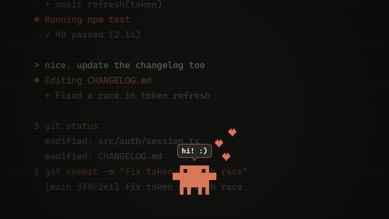

# Clawd Desk Buddy

A tiny Clawd who lives on your desktop. He wanders around the whole screen, follows your cursor when it stops, and reacts when you click. You can pet him, feed him, play ball with him, high-five him and pick him up. Every so often he walks down to the taskbar and taps the clock or the battery icon to tell you the time or your charge. If you leave the mouse alone, he naps.

## Download

- **Live wallpaper (Lively):** [Clawd-Desk-Buddy.zip](https://github.com/Hirukadeven07/Live-Wallpaper/raw/main/wallpapers/clawd-desk-buddy/Clawd-Desk-Buddy.zip). Don't unzip it; drag it onto the Lively window.
- **Still images (no app needed):** the [still-images](still-images) folder.

New to this? Follow the [step-by-step instructions](../../README.md#how-to-use-a-live-wallpaper) on the main page.

## Set it up

1. **Add the wallpaper to Lively** and click its tile.
2. **Let Clawd see your mouse (needed).** In Lively, open **Settings**, go to **Wallpaper**, and set **Wallpaper input** to **Mouse**. Without this he can't follow your cursor or react to clicks.
3. **Press Win + D and try it.** Rest your cursor somewhere, click him, rub the cursor over him, or double-click empty desktop for a ball. The full list is in [Things to try](#things-to-try).
4. Optional: right-click the tile and choose **Customise** for the background (or your own picture), Clawd's size, naps and toys.

## Things to try

**With your cursor**

| Do this | Clawd does this |
| --- | --- |
| Rest your cursor somewhere | He walks over and stands next to it |
| Hover over him | He waves |
| Rub the cursor back and forth over him | Petting! He squints happily and hearts float up |
| Hold the cursor still on top of him | He jumps up and boops it |
| Wiggle the cursor fast near him | He chases it like a laser pointer |
| Fling the cursor right through him | He spins: "whoa!" |
| Scroll the mouse wheel over him | He spins |

**With clicks**

| Do this | Clawd does this |
| --- | --- |
| Click him | Hearts and a little dance |
| Click him while he's waving | High five! |
| Double-click him | Break-dance |
| Click him five times quickly | He gets dizzy |
| Click near him | He jumps with a "!" |
| Click somewhere else | He runs over to see what you clicked |
| Click a steady beat on the desktop | He dances to it, faster for a faster beat |
| Drag a selection box around him | "hey! don't select me" and he hops out of it |
| Drag him | You pick him up. Throw him and he bounces off the taskbar. |

**Toys**

| Do this | Clawd does this |
| --- | --- |
| Press and hold on empty desktop | A cookie drops. He runs over and munches it. Three snacks and he's too full and naps. |
| Double-click empty desktop | A ball drops in. He chases it and kicks it around, and you can click the ball to bat it too. |

**On his own**

| When | Clawd does this |
| --- | --- |
| You leave the mouse alone | He yawns and falls asleep. Move the mouse to wake him. |
| You come back after a while | "welcome back!" (or "good morning!" before 11:00) |
| You open your PC on a new day | He remembers you: "hi again!", "happy friday!", "monday again..." |
| Between 7:00 and 10:00 | Morning coffee, once a day |
| Every so often | Throws a paper plane across your screen, sits at a laptop, dances, meditates |
| You plug in your charger | He wakes up and runs to the battery icon |
| The battery drops to 20% or 10% | He goes and warns you |
| On the hour | He taps the clock: "ding! 3 PM" |

He walks on the top edge of your taskbar. Lively draws wallpapers behind the taskbar, so he taps the clock and battery from just above them rather than on top of them.

## Settings

Right-click the wallpaper in Lively and choose **Customise**.

| Setting | Options | Default |
| --- | --- | --- |
| Background | Paper, Graph paper, Midnight terminal, Dunes, Clay glow, Your own picture | Graph paper |
| Your own picture | Any picture you add with the **+** button. Used when Background is set to Your own picture. | Claude Dunes at sunset |
| Appearance | Match Windows, Light, Dark, Follow the clock | Match Windows |
| Clawd size | Tiny, Small, Medium | Tiny |
| Where Clawd walks | The whole screen, or only along the taskbar | The whole screen |
| Your cursor | Ignore it, Look at it, Follow it when it stops, Chase it everywhere | Follow it when it stops |
| Your clicks | Ignore them, React to them, React and run to them | React and run to them |
| Taskbar visits (clock and battery) | Never, Sometimes, Often | Sometimes |
| Taskbar height | Auto, Hidden (auto-hide), 40, 48, 56 or 64 px | Auto |
| Naps when the mouse is idle | Never, after 1, 3, 5 or 10 minutes | After 3 minutes |
| Reacts to the hour and to your battery | On or off | On |
| Toys: snacks, ball, paper planes and coffee | On or off | On |
| Speech bubbles | On or off | On |
| Frame rate | 15, 30 or 60 fps | 30 fps |

**Taskbar height:** if Clawd floats above your taskbar or sinks behind it, pick the height that matches. Windows 11 uses 48 px, Windows 10 uses 40 px. Choose Hidden if your taskbar auto-hides.

**Follow the clock:** night until 6:00, sunrise until 7:30, day until 18:00, sunset until 19:30, then night again. At night (23:00 to 5:00) Clawd yawns more and naps twice as soon.

**Battery:** reactions only happen on laptops, and only when Windows reports the battery to the wallpaper.

## Still images

All are 2560 x 1600. Clawd is tiny on purpose, standing just above where the taskbar goes.

| Graph paper (dancing) | Midnight terminal (at the laptop) | Dunes at night (asleep) |
| --- | --- | --- |
| [clawd-desk-buddy-graph-paper.png](still-images/clawd-desk-buddy-graph-paper.png) | [clawd-desk-buddy-terminal.png](still-images/clawd-desk-buddy-terminal.png) | [clawd-desk-buddy-dunes-night.png](still-images/clawd-desk-buddy-dunes-night.png) |

## Notes

Clawd's sprites and moves come from the Claude desktop app, and the character belongs to Anthropic. The sleeping and happy poses are drawn from his standing frame for this wallpaper. He remembers your visits and his morning coffee in the wallpaper's own storage on your PC; nothing leaves your computer. The sample picture is the sunset still from [Claude Dunes](../claude-dunes). This is an unofficial fan wallpaper for personal use. See the [notices](../../README.md#license-and-notice).
