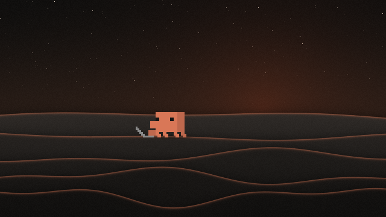

# Clawd Dunes

Clawd, the Claude Code mascot, living on the dunes. He walks in from the left, waves, then wanders. Now and then he sways, turns around, dances, break-dances, meditates, looks around, thinks, or sits down at a laptop or a desktop computer. When he's standing still he turns toward your cursor. The sky follows your Windows theme (or the time of day).

## Use it

Open [Live Wallpaper](../../README.md#get-it) and click **Clawd Dunes**. That's all; there's nothing to set up.

## Settings

They're on the right of the Live Wallpaper window while Clawd Dunes is selected, and every change shows on the desktop straight away.

| Setting | Options | Default |
| --- | --- | --- |
| Appearance | Match Windows, Light, Dark, Follow the clock | Match Windows |
| Show Clawd | On or off | On |
| Clawd size | Small, Medium, Large | Medium |
| Clawd turns toward your cursor | On or off. Only when he's standing still. | On |
| Dune motion | 0 to 300%. At 0 the dunes stand still. | 100% |
| Frame rate | 15, 30 or 60 fps | 30 fps |
| Stars at night | On or off | On |
| Paper grain | On or off | On |

**Follow the clock:** night until 6:00, sunrise until 7:30, day until 18:00, sunset until 19:30, then night again.

## Still images

All are 2560 x 1600, if you'd like a plain picture instead.

| Night (at the laptop) | Day (waving) | Sunset (at the desktop computer) |
| --- | --- | --- |
| [clawd-dunes-night.png](still-images/clawd-dunes-night.png) | [clawd-dunes-day.png](still-images/clawd-dunes-day.png) | [clawd-dunes-sunset.png](still-images/clawd-dunes-sunset.png) |

## Using Lively instead?

[Clawd-Dunes.zip](https://github.com/Hirukadeven07/Live-Wallpaper/raw/main/wallpapers/clawd-dunes/Clawd-Dunes.zip) works in [Lively Wallpaper](https://github.com/rocksdanister/lively). Drag the zip (don't unzip it) onto Lively's window and click its tile. For Clawd to see your cursor, set Lively's **Settings > Wallpaper > Wallpaper input** to **Mouse**.

## Notes

Clawd's sprites and idle moves come from the Claude desktop app, and the character belongs to Anthropic. The laptop, desktop computer, looking around and thinking moves are used as extra idle moves in this wallpaper. This is an unofficial fan wallpaper for personal use. See the [notices](../../README.md#license-and-notice).
