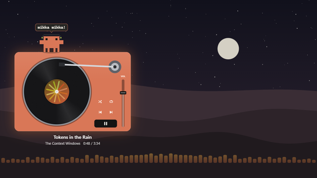
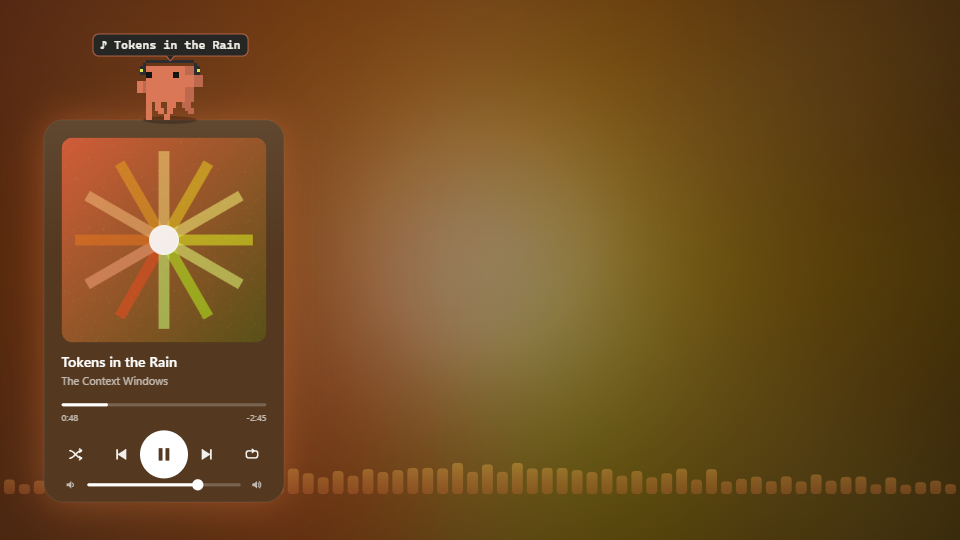
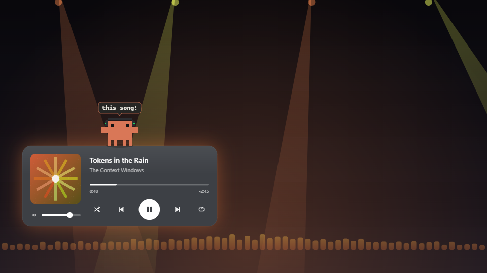
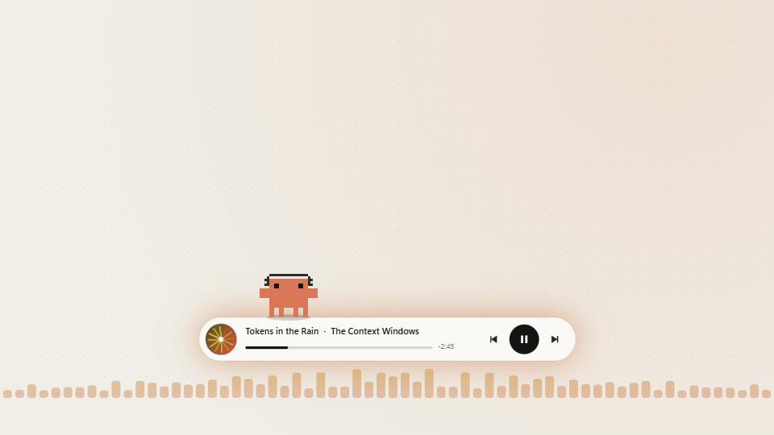
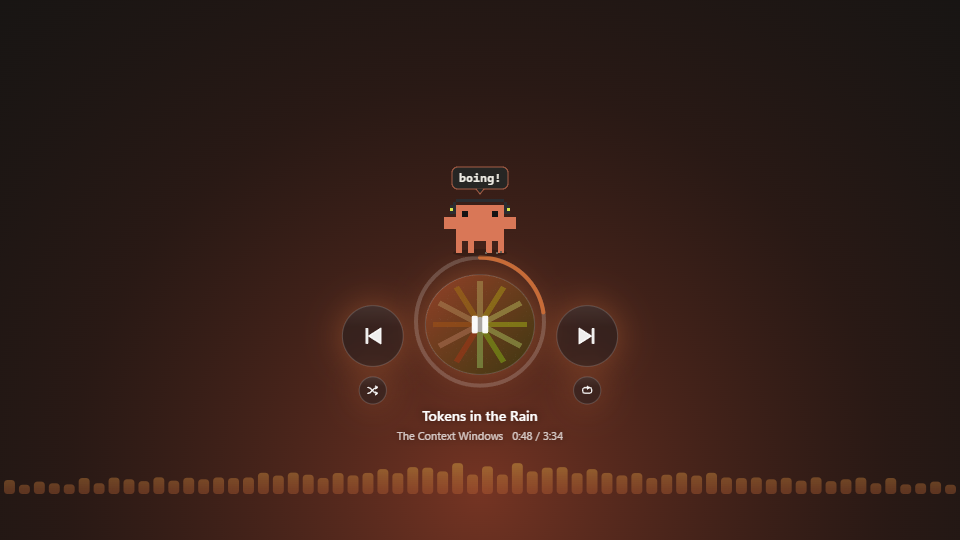
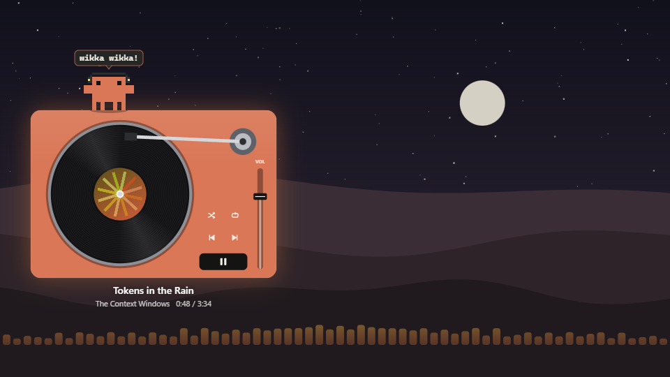

# Clawd Tunes

A music player for Spotify sits on your desktop, and Clawd stands on top of it with his headphones on. He dances to whatever you're playing, reads out each new song, freezes mid-move when you pause, cheers when you skip, and loses it when the beat drops. The player's buttons really control Spotify, and you can pick from five styles: a classic card, a wide player, a slim bar, floating bubbles, or a record player.

It listens to Spotify only. Other apps' music doesn't count.

## Use it

1. Open [Live Wallpaper](../../README.md#get-it) and click **Clawd Tunes**. It hears Spotify and takes your clicks by itself; there's no helper to start and no setting to switch on.
2. **Play something in the Spotify app.** The player fills in, Clawd puts his headphones on and starts dancing.

> [!NOTE]
> It works with the Spotify app for Windows, from Spotify's website or the Microsoft Store. The Spotify web player in a browser doesn't count, because Windows reports that as the browser playing.

Want to see it without Spotify? Tick **Play made-up demo songs until Spotify is linked** in its settings.

## The players

Pick one with **Player style**.

| Style | What it looks like | What Clawd does there |
| --- | --- | --- |
| **Classic card** | A tall card with a big album cover, progress bar, controls and a volume slider | Dances on top, moonwalks along the edge now and then |
| **Wide** | Cover on the left, song, progress and controls on the right | Same, with more room to move |
| **Slim bar** | A thin pill with a spinning cover, song name and three buttons | Walks along the top as the song plays, so he's the progress marker |
| **Bubbles** | A big round play button filled with the cover, a progress ring around it, and round skip buttons | Bounces on top of the play bubble like a trampoline, and the bubble squashes when he lands |
| **Turntable** | A record player: the cover is the record's label, the tone arm follows the song, and there's a volume fader | DJs from the deck |

  
  
  
  
  

## Putting the player where you want it

- **Drag it.** Press on an empty part of the player and drag. It stays where you leave it.
- **Or pick a spot in the settings.** **Where the player sits** has six ready-made spots. **Your own spot** lets you place it anywhere with the **Horizontal position** (left to right) and **Vertical position** (top to just above the taskbar) sliders. 50% and 50% is the middle of the screen.
- **It keeps its distance from the edges.** However you place it, it stays **Gap from the screen edges** away from every edge and the taskbar (40 px unless you change it), so it never jams into a corner. There's always room above it for Clawd.
- **Put it back.** The **Put it back** button returns the player to where it started (bottom left, 40 px from the edges) and undoes any dragging.

## Using the player

| Do this | What happens |
| --- | --- |
| Click play, pause, skip or previous | Spotify does it |
| Click the album cover | Play or pause |
| Click shuffle | Shuffle on or off |
| Click repeat | Off, then repeat the whole list, then repeat this song |
| Click or drag the progress bar (or the ring, on Bubbles) | Jump to that part of the song |
| Drag the volume slider, or scroll over the player | Spotify's volume |
| Click the little speaker | Mute Spotify |
| Turntable: tap the record's grooves | Drop the needle there |
| Turntable: drag the record round | Scratch it: clockwise skips ahead, anticlockwise goes back |
| Turntable: tap the label | Play or pause |

The volume here is Spotify's slider in the Windows volume mixer, not the one inside Spotify. Both have to be up to hear anything.

## What Clawd does

| When | Clawd does this |
| --- | --- |
| A song is playing | Dances on beat, nods along, spins, break-dances when it's loud, sways when it's slow. Music notes float up off the player |
| The beat drops | Leaps, sparks fly: "DROP!" |
| A new song starts | Hops and reads out its name: "♪ Song name" |
| You pause | Freezes mid-move: "hey, i was dancing!" |
| You press play again | "back on!" |
| You skip, or go back | Hops and kicks: "skip!", or "one more time!" |
| You jump ahead in the song | "whoosh!" |
| You turn on shuffle or repeat | Spins: "shuffle!", "on repeat!" |
| You turn it all the way up | "so loud!" |
| You mute | "shh..." |
| An ad comes on | Has a coffee: "ad break..." |
| The song's nearly over | Sometimes: "ooh, what's next?" |
| It's been paused a while | Looks at the play button: "play more?" Click him and he jumps on it for you |
| Spotify is closed | "open spotify?" Click him and he opens it |
| No music and no mouse for a while | Takes a nap. Music wakes him up |

He also keeps count, on your PC only: "25 songs today!", and once an artist comes up often enough, "you really like (artist)!"

And you can play with him:

| Do this | Clawd does this |
| --- | --- |
| Click him | Hearts and a dance. Click twice quickly for a break-dance |
| Rub the cursor back and forth over him | He loves being petted |
| Hover over him | Waves. Click while he's waving for a high five |
| Pick him up and throw him | He flies, bounces and lands. Throw him onto the top of the player and he lands on it |
| Throw him onto a button | He stomps it and presses it: skip by throwing Clawd at the skip button |
| Scroll over him | Spins |
| Click a steady beat on the empty desktop (no music playing) | Dances to your beat |
| Drag the player away | "whoa, earthquake!" He rides along |

## Settings

They're on the right of the Live Wallpaper window while Clawd Tunes is selected, and every change shows on the desktop straight away.

| Setting | Options | Default |
| --- | --- | --- |
| Player style | Classic card, Wide, Slim bar, Bubbles, Turntable | Classic card |
| Where the player sits | Bottom left, Bottom right, Bottom middle, Top left, Top right, Middle of the screen, Your own spot | Bottom left |
| Horizontal position | 0% (left) to 100% (right), when the spot above is **Your own spot** | 0% |
| Vertical position | 0% (top) to 100% (bottom), when the spot above is **Your own spot** | 100% |
| Gap from the screen edges | 0 to 200 px | 40 px |
| Put the player back where it started | **Put it back** button | |
| Player size | Small, Medium, Large | Medium |
| Player colours | Match the album cover, Charcoal, Clay, Frosted glass, Paper | Match the album cover |
| Music visualiser | Off, Bars along the bottom, Glow around the player, Bars and glow | Bars and glow |
| Time on the right | Time left, Song length | Time left |
| Background | Album glow, Stage lights, Paper, Dunes, Clay glow, Your own picture | Album glow |
| Your own picture | Any picture you add with the **+** tile under the pictures | Claude Dunes at sunset |
| Appearance | Match Windows, Light, Dark, Follow the clock | Match Windows |
| Clawd size | Tiny, Small, Medium | Small |
| How much Clawd dances | Chill, Normal, Party | Normal |
| Your cursor | Ignore it, Look at it | Look at it |
| Naps when there's no music and no mouse | Never, after 1, 3, 5 or 10 minutes | After 3 minutes |
| Clawd reads out each new song | On or off | On |
| Speech bubbles | On or off | On |
| Play made-up demo songs until Spotify is linked | On or off | Off |
| Taskbar height | Auto, Hidden, 40, 48, 56 or 64 px | Auto |
| Frame rate | 15, 30 or 60 fps | 30 fps |

**Match the album cover** and **Album glow** take their colours from the cover of whatever's playing, and fade to the next song's colours when it changes. **Stage lights** swing faster when the song is louder.

**Music visualiser:** the bars follow what your speakers are playing. They only move while Spotify is playing, so a YouTube video in the background doesn't set them off.

**Where the player sits:** changing this, or moving the position sliders, puts the player back in that spot, even if you'd dragged it somewhere else.

## How Clawd hears Spotify

Live Wallpaper has Clawd's Ears built in. While this wallpaper is showing, several times a second it:

1. Asks Windows' media controls what Spotify is playing: the song, artist, album, cover, position, and whether it's playing, shuffled or on repeat. These are the same controls behind the media pop-up you get when you press a volume key.
2. Asks the Windows volume mixer how loud Spotify is right now, and where its volume slider is.
3. Hands that to the wallpaper, in memory.

The player's buttons go to it the same way. No network port is opened, and only this wallpaper can reach it. It never signs in to Spotify or sees your account, and nothing leaves your PC. It only changes something when you click a button on the player (or throw Clawd at one), and it stops by itself when you switch to another wallpaper.

## Using Lively instead?

In [Lively Wallpaper](https://github.com/rocksdanister/lively) this wallpaper needs two downloads:

- [Clawd-Tunes.zip](https://github.com/Hirukadeven07/Live-Wallpaper/raw/main/wallpapers/clawd-tunes/Clawd-Tunes.zip): drag it (don't unzip it) onto Lively's window and click its tile. Set Lively's **Settings > Wallpaper > Wallpaper input** to **Mouse**, or the buttons can't be clicked.
- [Clawd-Ears.zip](https://github.com/Hirukadeven07/Live-Wallpaper/raw/main/wallpapers/clawd-tunes/Clawd-Ears.zip), the helper that lets Clawd hear Spotify under Lively: unzip it somewhere you'll keep it and double-click **Start Clawd Ears.cmd**. It sits in the tray; right-click it for **Start with Windows** and **Quit**. If Windows won't run it, right-click the zip, choose **Properties**, tick **Unblock**, and unzip it again. It answers the player's buttons on `127.0.0.1` port 47823 with a random key; if the song shows but the buttons don't work, something else is using that port, and `clawd-ears.log` in `%TEMP%` says what.

Under Lively, **Put it back** only undoes dragging; it can't move Lively's sliders.

## Notes

There are no still images for this one. The player only makes sense live, with your own music in it.

Clawd's sprites and moves come from the Claude desktop app, and the character belongs to Anthropic. The headphones, the players, the made-up demo songs and their covers are drawn for this wallpaper. Spotify is a trademark of Spotify AB; this wallpaper isn't made or endorsed by Spotify, and it only uses the media controls Windows gives every app. The sample picture is the sunset still from [Claude Dunes](../claude-dunes). This is an unofficial fan wallpaper for personal use. See the [notices](../../README.md#license-and-notice).
