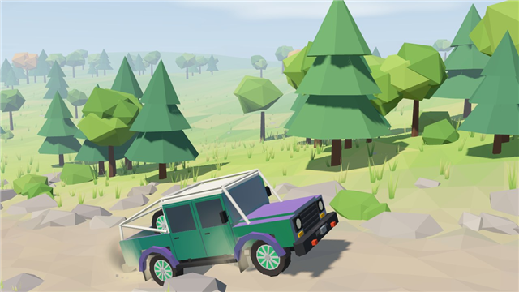

# Scarab Trail

A low-poly off-road trip that plays out on your desktop from morning to night. The Scarab 110, a made-up overland pickup, struggles up a rocky climb, gets stuck in a mud bog and winches itself out, crosses a river carefully, and pulls into camp at sunset, where friends are waiting by the fire. Then the night fades and a new morning starts.

## Use it

Open [Live Wallpaper](../../README.md#get-it) and click **Scarab Trail**. That's all; there's nothing to set up. One trip takes about four and a half minutes, then it starts again.

## The story

Times are at the normal story speed.

| When | What happens |
| --- | --- |
| 0:00 | Morning. The truck rolls along a dirt trail through a meadow. |
| 0:15 | **The rocky climb.** It crawls over the rocks, stalls at a big ledge with its tyres scrabbling and throwing dust, rolls back, and makes it on the second try. |
| 1:05 | **The mud bog.** It slows right down and sinks in, wheels spinning and flinging mud. |
| 1:20 | **The winch.** The driver climbs out, carries the winch rope to a tree, straps it on, stands well clear and winches the truck out. Then they unhook the rope, reel it in and drive on. |
| 2:50 | **The river.** The truck stops at the water's edge for a look, then crosses slowly with a bow wave around it. It comes out dripping, with some of the mud washed off. |
| 3:35 | **Camp.** It pulls in at sunset with the headlights on. A friend waves, the driver walks over and sits down by the fire, and night falls: stars, sparks, fireflies, a glowing tent and string lights. |

## The truck

The Scarab 110 Crew Cab is a fictional overlander. Its emerald paint shifts to purple where it catches the light, with purple wheel-arch flares, a white roof and roll cage over the cab and bed, black steel bumpers with a winch, round headlights, a spare wheel standing in the bed, and ten-spoke wheels with green inserts. It gets muddier as the trip goes on.

## Settings

They're on the right of the Live Wallpaper window while Scarab Trail is selected, and every change shows on the desktop straight away.

| Setting | Options | Default |
| --- | --- | --- |
| Time of day | Follow the story (morning to night), Always daytime, Always golden hour, Always night | Follow the story |
| Story speed | 50 to 200% | 100% |
| Camera | Close, Medium, Far | Medium |
| Frame rate | 15, 30 or 60 fps | 30 fps |
| Render quality | Battery saver, Balanced, High (full resolution) | Balanced |
| Shadows | On or off | On |

This is a full 3D scene, so it works the graphics chip harder than the other wallpapers. On a laptop running on battery, try **Render quality: Battery saver**, **Frame rate: 15 fps** or turning **Shadows** off.

## Still images

All are 2560 x 1600, if you'd like a plain picture instead.

| Day (the rocky climb) | Sunset (heading for camp) | Night (at camp) |
| --- | --- | --- |
| [scarab-trail-day.png](still-images/scarab-trail-day.png) | [scarab-trail-sunset.png](still-images/scarab-trail-sunset.png) | [scarab-trail-night.png](still-images/scarab-trail-night.png) |

## Using Lively instead?

[Scarab-Trail.zip](https://github.com/Hirukadeven07/Live-Wallpaper/raw/main/wallpapers/scarab-trail/Scarab-Trail.zip) works in [Lively Wallpaper](https://github.com/rocksdanister/lively). Drag the zip (don't unzip it) onto Lively's window and click its tile.

## Notes

The low-poly, pastel look is a nod to off-road games like Over the Hill; this wallpaper isn't connected to that game or its makers. The Scarab 110 isn't a real vehicle. Everything in the scene is drawn by the wallpaper itself, with no downloads or pictures. See the [notices](../../README.md#license-and-notice).
